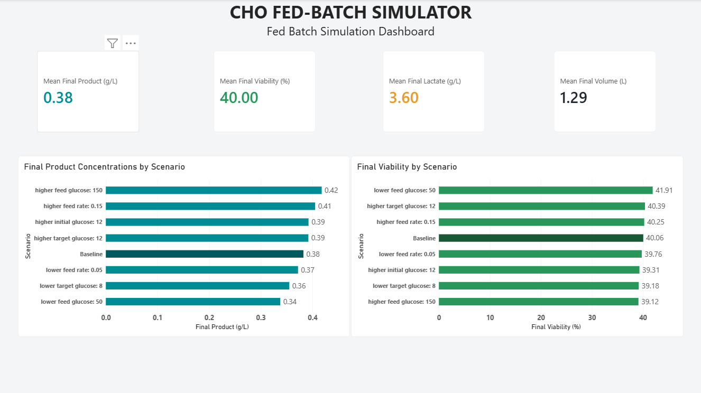
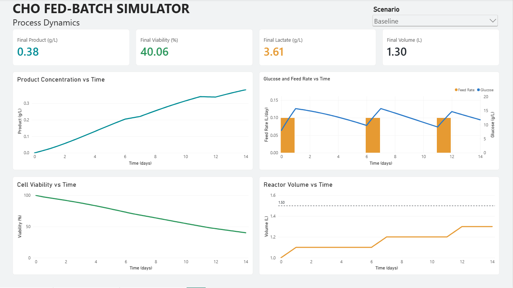
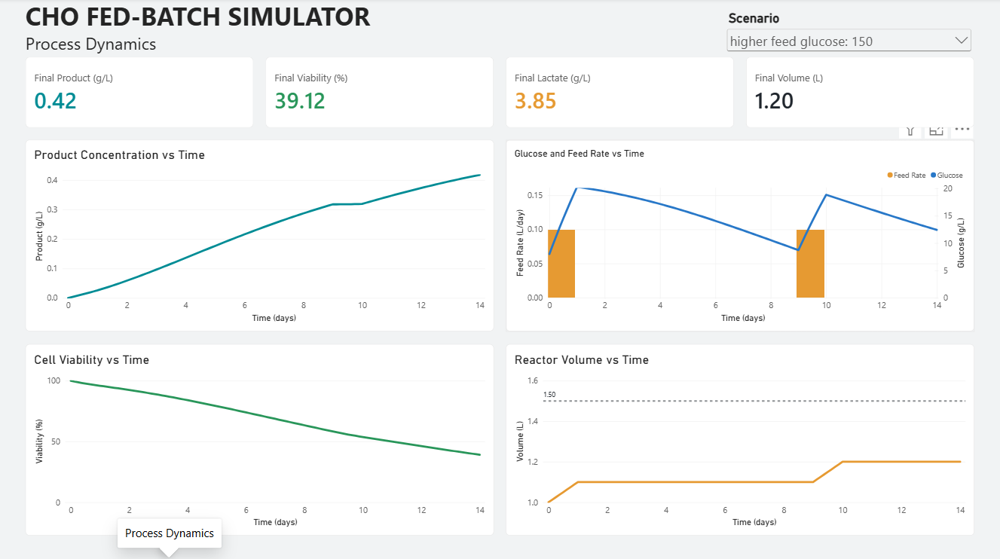

# CHO Fed-Batch Simulator

I built this Python simulator for Chinese hamster ovary (CHO) cell culture,
with SQLite run tracking and a Power BI dashboard for exploring feeding scenarios.
Developed to learn how bioprocess equations become a reproducible computational
workflow. This is an educational simulator, not an experimentally validated
digital twin or an industrial control system.

## Current features

- Glucose-dependent growth with lactate and ammonia inhibition.
- Health-dependent death and product formation.
- Smooth switching between lactate production and consumption.
- Cell-free glucose feeding with a glucose target and a volume cutoff.
- Three-hour biological steps and separate daily feed-controller decisions.
- Time-series CSV exports, SQLite summaries, and parameter metadata.
- Power BI scenario comparisons and process-dynamics visualization.
- Automated tests for model functions and the isolated export workflow.

## Dashboard preview







The overview summarizes all eight illustrative scenarios. The dynamics images
show the baseline and the 150 g/L feed-glucose scenario. These are simulated
outcomes, not measurements from a physical reactor.

## Installation

The current environment was tested with Python 3.14.5, NumPy 2.4.6,
pandas 3.0.3, and Matplotlib 3.11.0 on Windows. A fresh isolated environment
also passed all 12 tests with NumPy 2.5.4, pandas 3.0.6, and Matplotlib 3.11.2.
Both environments passed dependency checks. Other Python versions have not
been verified. A local interpreter-location warning appeared but did not
prevent the successful tests.

From the repository root, using PowerShell:

```powershell
python -m venv .venv
.\.venv\Scripts\python.exe -m pip install -r requirements.txt
.\.venv\Scripts\python.exe -m pip check
.\.venv\Scripts\python.exe -B -m unittest discover -s tests -v
.\.venv\Scripts\python.exe src/growth_simulator.py
```

Do not recreate an environment you already use unless you intend to replace it.
On macOS/Linux, use `.venv/bin/python` in place of the Windows executable path.
The simulator has no command-line scenario options. It displays plots in
sequence; close each plot window to continue.

## Running and changing scenarios

Edit the settings in `main()` in `src/growth_simulator.py`, then run the script.
The reference settings in `BASELINE_PARAMETERS` identify the standard scenario;
leave them unchanged when exploring alternatives.

For example, changing `feed_rate_on` from 0.1 to 0.2 L/day generates the label
`higher feed rate: 0.2`. Multiple changes are joined into one label. The script
runs one configuration per invocation; it does not automatically run a batch
of scenarios.

Default settings include 14 days, initial volume 1 L, initial glucose 8 g/L,
feed glucose 100 g/L, feed flow 0.1 L/day, target glucose 10 g/L, and feeding
cutoff volume 1.5 L. The separately discussed 2 L physical capacity is not an
active safety-interlock implementation in this version.

## Model and units

Time is in days; metabolites are in g/L; volume is in L; cell concentrations
are in million cells/mL. Specific metabolic rates are in pg/(cell.day).

Health is computed as:

```text
h = G/(Ks + G) * Kl/(Kl + L) * Ka/(Ka + A)
mu = mu_max * h
kd = kd_min + (kd_max - kd_min) * (1 - h)
```

Here G, L, and A denote glucose, lactate, and ammonia concentrations.
The lactate state and net specific rate are:

```text
s = 1 / (1 + exp(-steepness * (mu - mu_switch)))
qL_dynamic = s*qL_production - (1-s)*qL_consumption
```

The sigmoid steepness must have units of days so its exponent is dimensionless;
the current source comment incorrectly calls it dimensionless.

For each interval, biological rates are held at their starting-state values.
Total viable cell number evolves as `Nv_new = Nv_old * exp((mu-kd)*dt)`.
Deaths are `kd * integral(Nv(t) dt)`. Cell numbers are then divided by the new
reactor volume to account for dilution exactly once.

Metabolites use starting viable-cell numbers, not integrated cell exposure.
Their balances add feed/formation and subtract consumption from total mass,
then divide by the updated volume. Glucose consumption is capped by available
glucose mass, including interval feed. Lactate is prevented from becoming
negative. Volume follows `V_new = V_old + F*dt`.

Feed commands are calculated daily and held between decisions. Feeding is off
when sampled glucose is at/above its target or volume reaches the cutoff.
The command and interval flow are capped to avoid exceeding the feeding volume.
This is sampled feedback logic, not a continuously responding controller.

## Outputs and Power BI

Paths are resolved relative to the script, independent of the terminal directory:

```text
data/database/cho_digital_twin.db
data/csv/simulation_<Simulation_ID>.csv
```

Each run appends to `simulation_results` and `simulation_summary` and records
its parameters, UTC timestamp, and model-version label in `simulation_metadata`.
IDs are local to the database. Existing historical runs are not backfilled with
metadata. A reset/replaced database can reuse CSV IDs; preserve prior outputs.

The final feed value is blank in CSV and NULL in SQLite because no outgoing
interval follows the final timestamp. Total feed is the sum of applied flow
times interval duration, excluding that final value. Glucose extrema refer to
sampled timestamps rather than a continuously observed trajectory.

Open `CHO_demo.pbix` for the current release. `CHO.pbix` is the historical report.
Configure the local SQLite source using
your installed connector/ODBC setup. SQLite connectivity is not provided by
Python requirements. The supplied demo database is
`data/demo/20261010T184644691930Z/data/database/cho_digital_twin.db`.
Create a local 64-bit SQLite ODBC DSN and update the report's Source connection
to that DSN for both queries. Refresh both results and summary tables. Check the
one-to-many relationship from summary to results on `Simulation_ID` and ensure
`Days` is a decimal number so three-hour timestamps remain distinct.

The dashboard contains Simulation Overview and Process Dynamics pages.
Repeated runs with the same scenario label can be averaged by the current
visuals; filter by simulation ID when examining a particular run. Historical
data were generated with earlier settings and should not be mixed with new
runs without identifying their provenance. Renamed scenarios may require
updating any fixed-label baseline formatting in the report.

## Tests

The active suite has 12 tests covering volume, feed switching/caps, health,
death-rate endpoints, lactate switching, growth/death/dilution, metabolite
balances, depletion caps, scenario labels, and the main export workflow.
The workflow test uses an in-memory database and a temporary folder and
suppresses plots; it does not write to the real project exports.

Tests check implementation behavior, not experimental accuracy. A step-size
comparison gave final product values of 0.410280 g/L at dt=1 day,
0.382444 g/L at dt=0.125 day, and 0.380617 g/L at dt=0.0625 day.
The controller interval remained one day. This supports using smaller
biological steps but is not a proof of convergence for every scenario.

## Limitations

- Parameters are illustrative and have not been fitted to experimental data.
- Rates are frozen within each step; this is not a continuous ODE solver.
- Uptake caps do not reduce full-step growth/product activity when glucose
  depletes partway through an interval.
- No dead-cell lysis, oxygen/pH control, glutamine balance, evaporation, sampling
  loss, or biomass/elemental-yield constraint is modeled.
- No physical sensors, PLC connection, alarms, or safety certification.
- Simultaneous runs and cross-table export transaction recovery are not handled.

## Project layout

```text
src/growth_simulator.py       Active simulator and plotting functions
tests/test_growth_simulator.py
notebooks/                   Learning and practice notebooks
data/csv/                    Run exports
data/database/               SQLite database
CHO.pbix                     Power BI report
CHO_demo.pbix                Current demonstration report
requirements.txt             Active Python dependencies
```

An earlier, unused ODE experiment is retained in a locally ignored archive.
It is not the active model and its tests do not validate this release.

## Roadmap

The next learning-focused release will add ODE integration and PLC-inspired
control simulation: separate controller timing, manual/automatic/off modes,
pump limits, interlocks, and operating-scenario tests. 

## Development approach

Most simulator code was written by me. AI was used for concept
explanations and review, with implementation assistance during final refinements,
testing, and release preparation. The project builds on my undergraduate exposure
to bioprocess simulation through independent implementation and exploration.

## Reproducing the demo

```powershell
.\.venv\Scripts\python.exe -B data/demo/generate_demo.py
```

This helper uses syntax-tree overrides of explicit settings in `main()` to run
eight configurations without changing the source file. It creates a new UTC-named
folder, isolated database, CSVs and manifest on each invocation, and suppresses
plot windows. Revisit the helper if the simulator's settings structure changes.
Repoint Power BI to the newly generated database if you use fresh outputs.

The supplied demo was generated before a schema-only correction from Days INTEGER
to Days REAL; its manifest records the original generation source hash. All 904
rows and their values were preserved during the correction. New generated demos
use the corrected REAL schema directly.

## License

MIT License; see LICENSE. The model is provided without warranty and is not
intended for making real reactor operating or safety decisions.
